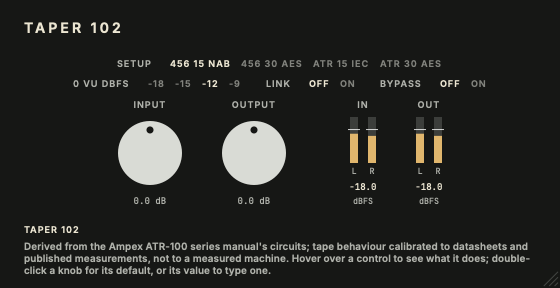

# Taper 102

Inspired by the Ampex ATR-102 mastering tape recorder.

Part of the codycodie plug-in collection.

Taper 102 is a tape machine model derived from the Ampex ATR-100 series manual: the record and reproduce
electronics from its circuits, the machine's alignment procedure done in software, and a tape medium
calibrated to datasheets and published measurements. The signal goes through the record equaliser, the
record amplifier's clip, the tape (456 or ATR Master, at 15 or 30 ips, with bias, saturation and
record-zone loss), the reproduce head's losses and contour, and the reproduce equaliser. It is an
independent model; it is not a measurement of a particular machine.



Identity: product `Taper 102`, company `codycodie`, bundle identifier `com.c0dypeng.taper102`,
manufacturer code `Cdpg`, plug-in code `T102`. AU and VST3, mono or stereo. The chain runs at 176.4 or
192 kHz internally (4x oversampling at 44.1 and 48 kHz, 2x at 88.2 and 96 kHz, none from 176.4 kHz). The
reported latency is the oversampler's: 5 samples at 44.1 and 48 kHz, 4 at 96 kHz and 0 at 176.4 kHz and
above; the electronics' own group delay (about 8 samples at 1 kHz) is not included. The IDs, ranges and
choice orders below are permanent; the saved state is versioned (schema 2).

## Downloads

Get the latest builds from [GitHub Releases](https://github.com/chijenpeng/taper-102/releases/latest).
The macOS package contains universal AU and VST3 plug-ins for Apple Silicon and Intel Macs; it is
ad-hoc signed and not notarized. The Windows package contains an unsigned x64 VST3.

## Controls

| Control | Range | What it controls |
|---|---|---|
| Setup | 456 15 ips NAB / 456 30 ips AES / ATR Master 15 ips IEC / ATR Master 30 ips AES (default 456 15 ips NAB) | The machine setup, aligned as in the manual. Each fixes the speed, the equalisation standard, the tape, the tape's aligned operating level (456 at 370 nWb/m, ATR Master at 320) and the bias at the aligned point. 456 15 NAB has the most tape colour (about +1.4 dB bump near 40 Hz, −0.7 dB at 20 kHz, 0.19 % THD at 0 VU, 3 % at +9.5 dB over 0 VU). 456 30 AES is cleaner and more open (0.11 %, smaller bump near 85 Hz, flat to 20 kHz). ATR 15 IEC saturates like 456 at 15 ips (0.175 %) with a smaller low bump (+0.6 dB). ATR 30 AES is the cleanest and flattest (0.13 %). Hover an option for its description. |
| Input | −24 … +24 dB (default 0) | Level into the record stage. At 0 dB a tone at the 0 VU level records at the operating level; each dB more drives the tape harder. |
| Output | −24 … +24 dB (default 0) | Level after the reproduce stage. At 0 dB, 0 VU in leaves at 0 VU in every setup. |
| Link | Off / On (default Off) | While on, an Input edit of d dB moves Output by −d dB (clamped), so driving the tape harder keeps the level roughly the same. Automating Input with Link on also moves Output; restoring a saved state never couples them. |
| 0 VU dBFS | −18 / −15 / −12 / −9 (default −12) | Which digital level the machine treats as 0 VU. −18 drives the tape hardest; −9 is the cleanest at the same dBFS (456 at 15 ips reaches 3 % distortion at −8.5 dBFS with −18 and at −2.5 dBFS with −12). The chain is calibrated to −18; the plug-in attenuates before the chain and restores the level after it. |
| Bypass | Off / On (default Off) | Plays the input instead of the tape, delayed by the reported latency so switching never shifts timing, with a short crossfade. |
| IN / OUT meters | Indicator | Stereo sample-peak bars of the real input and output, in dBFS, with a tick at the 0 VU setting. |

Every control and the meters carry hover help. Double-click a knob for its default or to type a value.
The window scales from 0.75x to 2x. Control changes reach the chain through a background thread at about
100 Hz (synchronously when the host renders offline). States saved by development versions with separate
Speed, EQ, Tape, Level and Bias controls (schema 1) load as the matching setup (456 at 15 ips becomes
456 15 ips NAB even if it was IEC; ATR Master at 15 ips becomes IEC; any 30 ips becomes AES) and ignore the
old level and bias; states without Link or 0 VU load with Link off and 0 VU at −18 dBFS.

### What was chosen for this plug-in

The following parts are not taken from the manual or from a measurement of a machine. Provenance labels:

- **Head contour: derived from one published curve.** No contour data for the ATR-102 reproduce head was
  found other than Jack Endino's published ATR-102 response measurement (1/2-inch two-track heads, 30 ips);
  the plug-in models the 1/4-inch two-track machine, so the curve is a stand-in for its contour. The
  low-frequency "bump" is a physical model of
  flux pickup from the tape either side of the head gap, with two terms fitted to that curve (rms error
  0.21 dB against the needed contour, about 0.6 dB at worst). Its frequencies scale with tape speed for
  15 ips, which is consistent with, but not a measurement of, reports of the 15 ips bump near 30 to 40 Hz.
  It is fixed in the chain and not a control.
- **Record gap: calibrated.** The record gap (7.62 µm) was calibrated so that the 15 ips high-frequency
  response matches the Audio magazine test of the ATR-100 (May 1977): about −3 dB at 26 kHz, 15 ips; the 12.7 µm gap used earlier
  lost twice as much there. The reproduce head geometry (spacing 0.25 µm, thickness 12.7 µm, gap
  3.05 µm) is a chosen model of the head.
- **Second harmonic: chosen within the manual's limit.** The tape curve is exactly odd, so a small
  constant record-field offset (0.103 kA/m) supplies the even harmonic. The manual limits the second
  harmonic to below 0.1 % at operating level; this gives 0.050 % at 0 VU, 997 Hz, 456 at 370 nWb/m, 15 ips.
  A real machine's value depends on its bias and alignment.
- **0 VU reference and Link.** The 0 VU choices and the Link behaviour are software conveniences; the
  machine has neither. The −18 dBFS calibration is the plug-in's.
- **Meters.** The −60 … +6 dBFS peak display and its layout are chosen for the plug-in.
- **Palette.** The "meter-panel black" colours borrow the colour language of photos of the ATR-102 panel;
  the values are chosen for the plug-in.

## Limits

- **No machine was measured.** The tape medium is calibrated to datasheets and published measurements
  (levels, bias and overbias curves, third-harmonic points, high-frequency response); a real machine, tape
  batch and head will differ, in particular in bias set-up, noise, wow and flutter, which are not modelled.
- **Operating level.** The 3 % third-harmonic point lands at about +9.5 to +10.1 dB over 0 VU on 456 at
  370 nWb/m; on ATR Master at 320 nWb/m it is about +9.7 to +10.0 dB, about 2.3 dB under the +12 dB on the ATR Master
  tape datasheet (3 % THD at +12 dB re 320 nWb/m).
- **Head contour.** Against that 30 ips curve the end-to-end error is within 0.63 dB (rms
  0.20 dB), with a dip near 120 Hz that the curve does not have. The 15 ips contour is that curve scaled
  by speed, not measured.
- **Second harmonic at low levels.** The model's second harmonic is a smooth curve; it does not follow the
  fine structure of the simulations behind it at low level.
- **Latency.** The reported latency excludes the electronics' group delay (about 8 samples at 1 kHz).
- **No Intel Mac runtime test, DAW-host test or Windows host test has been performed.**

## Build

Requires CMake 3.22+, Ninja, a C++17 compiler (Xcode command-line tools on macOS, Visual Studio 2022
on Windows). JUCE 8.0.9 comes from `third_party/JUCE` when that exists; otherwise CMake fetches the
tagged release.

```sh
cmake -S . -B build -G Ninja -DCMAKE_BUILD_TYPE=Release -DCOPY_PLUGIN_AFTER_BUILD=OFF
cmake --build build -j4
ctest --test-dir build --output-on-failure
./build/taper102_snapshot_artefacts/Release/taper102_snapshot docs/editor.png
```

For the universal macOS package, add `-DCMAKE_OSX_ARCHITECTURES="arm64;x86_64"` and run
`tools/package_macos.sh` from a clean, committed tree; it writes
`build-release/dist/taper-102-<version>-macos-universal.zip` and a `.sha256` companion. The bundles are
`build/Taper102_artefacts/Release/{AU,VST3}/Taper 102.*`.

Plug-in copying is disabled by default. Set `-DCOPY_PLUGIN_AFTER_BUILD=ON` only when you want CMake
to copy the AU and VST3 bundles to the current user's plug-in folders.

`Source/` holds the processor and editor; `Source/dsp/` holds the header-only chain (record and reproduce
electronics, alignment tables, tape medium and its tables).

| Target | Coverage |
|---|---|
| `taper102_processor_tests` | Parameter IDs, ranges and defaults, state save and restore, schema 1 migration, Link and 0 VU behaviour, bypass, latency, setups, bus layouts, sample rates, control changes and audio-thread allocations. |
| `taper102_hosted_test <Taper 102.vst3> [<Taper 102.component>]` | Loads the built VST3 (and, on macOS, the installed AU) through JUCE's plug-in hosting and checks that Link moves Output as a host sees it, for host message-thread and audio-thread automation. Runs under CTest on macOS (VST3). |
| `taper102_snapshot docs/editor.png [editorScale pixelScale helpId] [--setup2]` | Renders the editor without a host, optionally scaled, with a control's hover help or the 30 ips setup shown. |

## Validation

The chain is aligned in software the way the manual aligns the machine (reproduce equaliser, record
high-frequency trim, bias, level) and checked against the manual's response envelopes and the published
curves. Nothing here is a measurement of hardware.

- **Response.** Every setup is inside both of the manual's response envelopes after alignment; at 15 ips
  the 20 kHz response is about −0.6 to −0.8 dB and at 26 kHz about −3 dB on 456 and ATR Master.
- **Unity.** 0 VU in returns 0 VU out for all 24 combinations of tape, equalisation and operating level
  (worst error 0.0003 dB or better).
- **Distortion.** Total harmonic distortion at 0 VU, 997 Hz, 456 at 370 nWb/m, 15 ips: 0.186 % (second
  harmonic 0.050 %). Silence gives exactly zero output.
- **Latency.** Independent of the host block size (checked at 1 to 4096 samples and 44.1 to 192 kHz).
- **Release checks.** Version 0.1.0: CTest 1/1 (`taper102_processor_tests`) on macOS (Apple Silicon),
  universal arm64 + x86_64 AU and VST3 slices, and the snapshot tool. The Windows package is built and
  tested by the repository's release workflow.
